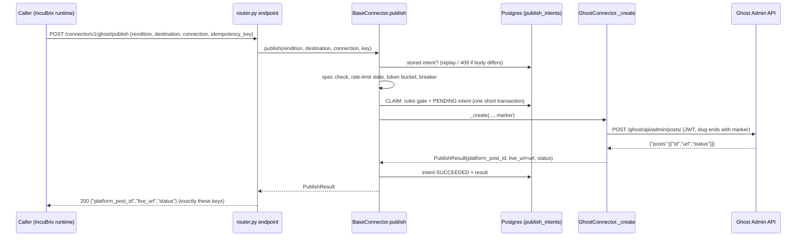

# Study guide for the live session

This guide is for the candidate. It prepares the four parts of the live session: the walkthrough, predict and run,
debugging and a live change. Every command in it was run on a real stack on 2026-10-20, and the answers shown are
the real output, shortened. Where something could not be run (it needs `--profile full` or a real account), the guide
says so.

Line numbers move when code changes. Each reference gives the file, the line on 2026-10-20 and the function name.
To find it again, run the `grep -n` shown next to it.

## 1. How to use this guide

**Two-day plan**

| When | What | How long |
|---|---|---|
| Day 1 morning | Read section 2 with the code open. Trace `live_url` yourself twice, out loud. | 2 h |
| Day 1 afternoon | Start a stack (section 3.0). Do the 10 drills in section 3: say the prediction, then run. | 2 h |
| Day 1 evening | Do 5 of the 9 debugging drills in section 4, with a timer (target under 10 min each). | 1.5 h |
| Day 2 morning | Do the three live-change rehearsals in section 5 in a throwaway copy. Time each one. | 2.5 h |
| Day 2 afternoon | Read section 6 out loud. Answer each question before reading the model answer. | 1.5 h |
| Day 2 evening | The other 4 debugging drills. Re-read the cheat sheet (section 7). | 1 h |

**Memorise:** the publish pipeline order (section 2.1), the D9 rules order, the 8 Appendix A error codes and when each
is retryable, the certification steps, the trust levels L0 to L4, and what does not work (section 6.4).

**Look up (do not memorise):** exact line numbers, setting names (README "Settings"), the full error table
(README "Error codes"), manifest limits (`app/connectors/<key>/manifest.yaml`).

## 2. Architecture walkthrough: trace `live_url`

`live_url` is the public URL of a post. It is created by the platform, read by the connector, checked by the
certification harness and stored in our database and evidence. That makes it the best field to trace.

### 2.1 Path (a): the contract call `POST /connector/v1/ghost/publish`



Each hop, in order. "Breaks if removed" is what you say when asked "why does this exist?".

| # | Where (2026-10-20) | Find it | What it does | Why it exists / what breaks without it |
|---|---|---|---|---|
| 1 | `app/contract/router.py:139` `_make_endpoint` | `grep -n "def _make_endpoint" app/contract/router.py` | One FastAPI route per method at `/connector/v1/{key}/{method}` (mirrored at `/api/v1/connector/...`). Parses the body into the request model, sets `CALL_META` and the `X-Sim-Fault` context, calls `_dispatch`, dumps the result. Adds `_meta` only with `X-IncuBrix-Verbose: 1`. | Appendix A says "expose each method over HTTP". Without it there is no contract. Without the "only with verbose" rule the response would have extra keys and the contract suite would fail. |
| 2 | `router.py:72` `get_connector` + `_connector_dependency` | `grep -n "def get_connector" app/contract/router.py` | Looks up the key in the registry (404 `CONNECTOR_NOT_FOUND`) and checks the method is in the manifest's `capabilities` (404 `METHOD_NOT_SUPPORTED`) before the body is validated. | A method the connector does not have must answer 404 with a clear code, not 422 about the body. |
| 3 | `router.py:125` `_publish_key` | `grep -n "def _publish_key" app/contract/router.py` | The idempotency key comes from the body, else the `Idempotency-Key` header; both but different → 409 `IDEMPOTENCY_KEY_REUSED` (`header_body_mismatch`); none → a generated key plus the warning header `X-IncuBrix-Warning: IDEMPOTENCY_KEY_GENERATED`. | IS4 (header on every POST) and MH6. Without it a retry without a body key could post twice. |
| 4 | `app/contract/models.py:32` `_Inbound` (`extra="allow"`), `:36` `_Outbound` (`extra="forbid"`), `:118` `PublishResult` | `grep -n "class _Outbound\|class PublishResult" app/contract/models.py` | Inbound models accept unknown fields (IncuBrix may send more). Outbound models forbid extra keys, so `PublishResult` is exactly `platform_post_id, live_url, status`. | MH1: "exact connector contract". Remove `forbid` and a stray key can leak into the response. |
| 5 | `app/connectors/base.py:182` `publish` | `grep -n "async def publish(" app/connectors/base.py` | The whole pipeline (steps 6 to 14). The module docstring at the top of `base.py` lists the order. | The connector only writes small hooks; every reliability rule lives here once. |
| 6 | `base.py:504` `_ensure_enabled` → `app/reliability/killswitch.py:27` | `grep -n "_ensure_enabled" app/connectors/base.py` | Kill switch from env `DISABLED_CONNECTORS` plus the DB table `connector_flags` (set by `PUT /api/v1/connectors/{key}/kill-switch`). Raises 503 `CONNECTOR_DISABLED`. Also records the connector for the IS9 manifest. | Appendix A code `CONNECTOR_DISABLED`. Without it you cannot stop a misbehaving connector without a deploy. |
| 7 | `base.py:182` step "1)" → `app/reliability/idempotency.py:68` `classify` | `grep -n "def classify" app/reliability/idempotency.py` | Reads the stored intent for the key. Same request hash + SUCCEEDED → replay the stored result (`Idempotent-Replayed: true`). FAILED → replay the same error. Different hash → 409 `IDEMPOTENCY_KEY_REUSED`. | MH6. It runs **before** the rules gate on purpose: a retry of a post that already went out must get its stored answer, not be blocked by the frequency cap that post used up. |
| 8 | `base.py:398` `spec_violations` → `app/rules/spec.py:112` `check_spec` | `grep -n "def spec_violations" app/connectors/base.py` | Checks the rendition against the manifest surface `spec` plus the destination's `spec_overrides` (title/body length, tags, media types). Any violation → 422 `DEST_SPEC_VIOLATION` with field-level `details.violations`. No platform call. | Spec (422) is checked before the rules (409), so a post that breaks both gets 422. Without it the platform rejects the post, which costs a call and gives a worse message. |
| 9 | `base.py:411` `simulate` | `grep -n "def simulate" app/connectors/base.py` | In `SIMULATION_MODE=true`, rewrites the destination and connection to mock-platforms with `sim-*` credentials. | MH7: everything runs with no real accounts. |
| 10 | `base.py:637` `_preflight` | `grep -n "async def _preflight" app/connectors/base.py` | (a) a stored rate-limit block from an earlier 429 → 429 `PLATFORM_RATE_LIMIT` with `short_circuit: true` and no call; (b) the local token bucket from `manifest.rate_limits`; (c) the circuit breaker (`app/reliability/breaker.py:84` `check`). | MH5 "back off on 429 using the reset time". Without (a) we would hammer a platform that told us to wait. Without (c) a dead platform gets every request. |
| 11 | `base.py:821` `_claim` | `grep -n "async def _claim" app/connectors/base.py` | One short transaction under two advisory locks (`publish:<key>` and `publish-dest:<destination_key>`): re-read the intent, run the rules gate, write the **PENDING** intent row with the marker. Commit releases the locks before the platform call. | Write-ahead intent: if we crash after the platform created the post, the PENDING/UNKNOWN row and the marker let the retry find it. The destination lock stops two parallel posts both passing a 1/P7D cap. No DB connection is held during the platform call (pool safety). |
| 12 | `base.py:916` `_rules_gate` → `base.py:957` `resolve_rules` → `app/rules/gate.py:59` `resolve_ruleset` → `app/rules/engine.py:31` `evaluate` → `gate.py:90` `apply_decision` | `grep -n "async def resolve_rules" app/connectors/base.py` | D9 order: inline `destination.rules` > Appendix A record fields on the destination (`frequency_cap`, `self_promo_allowed`, ...) > our catalogue's confirmed rules (by `destination_id`, else `destination_key`) > none. None → allowed, warning `rules_source=none_supplied`. History comes from `_history` (`base.py:989`): SUCCEEDED, PENDING and UNKNOWN intents on the same `destination_key`, minus certification test posts. Block/reschedule → 409 with the rule's code; "allow with changes" (AI disclosure) → the changed rendition. | MH4. Without D9's "none" branch the IncuBrix contract suite, which sends a bare Appendix A destination, would get 409 on every publish. |
| 13 | `base.py:869` `_reconcile` | `grep -n "async def _reconcile" app/connectors/base.py` | Only when the earlier attempt is UNKNOWN: call `_lookup(marker)` on the platform. Found → succeed with that post (`RECONCILED_EXISTING_POST`). Not found and younger than `IDEMPOTENCY_SETTLE_S` → 503 "retry shortly". | MH6 "even after a timeout". |
| 14 | `base.py:670` `_call` + `:688` `_translate` + `:728` `_after_call` | `grep -n "async def _call" app/connectors/base.py` | Runs the hook. Any exception becomes an `IbxError`: HTTP errors through `map_error` (`base.py:451`, manifest `error_map`), pydantic `ValidationError` → `PLATFORM_UNAVAILABLE reason=response_schema_mismatch`, timeouts → outcome `unknown` on a write. A 5xx/408 to a create is also `unknown`. Then updates the breaker, stores rate-limit blocks, pauses a stored connection on `CONNECTION_AUTH_EXPIRED`. | Core 3 (error mapping). "Outcome unknown" is what makes the retry reconcile instead of posting twice. |
| 15 | `app/connectors/ghost/connector.py:133` `_create` | `grep -n "async def _create" app/connectors/ghost/connector.py` | Builds the Ghost post: slug ends with the marker, body as one Lexical markdown card, never a `newsletter` parameter (no member emails), signs a 5-minute HS256 Admin JWT. `POST {admin}/posts/`. | The only Ghost-specific code on this path. |
| 16 | `app/connectors/ghost/platform_models.py:18` `GhostPost`, `:33` `OnePost`; `connector.py:109` `_result` | `grep -n "class GhostPost" app/connectors/ghost/platform_models.py` | `self.parse(response, OnePost)` validates the platform answer. Every field we read (`id`, `url`, `status`) is required. `_result` sets `live_url = post.url` only when the status is `published`. | Hard case "a platform renames a field": `url` → `permalink` raises a ValidationError, becomes `response_schema_mismatch`, outcome unknown, and certification fails and demotes. |
| 17 | `base.py:788` `_succeed` | `grep -n "async def _succeed" app/connectors/base.py` | Marks the intent SUCCEEDED and stores the result. If the same platform id already exists on **another instance** of this connector, the returned id is tagged `<id>~i<hash>` so Appendix A `get_status(platform_post_id, connection)` finds the right instance (MH1 fix). | Without it, mock tenants and fresh instances that all start at id 1 made `get_status/delete` ambiguous. |
| 18 | `app/api/errors.py:105` `_ibx_handler`, `:75` `error_response` | `grep -n "def error_response" app/api/errors.py` | Any `IbxError` becomes `{"error":{code,message,retryable,details}}` with `Retry-After` when `details` has `retry_at`/`retry_after_s`. Redaction runs on logs. | IS5. |

### 2.2 Path (b): the orchestrated path `POST /api/v1/publications`

| # | Where | Find it | What it does | Why / what breaks |
|---|---|---|---|---|
| 1 | `app/api/v1/publications.py:47` `create_publication` | `grep -n "async def create_publication" app/api/v1/publications.py` | Loads the destination (our catalogue row), stores the content, takes the per-destination advisory lock (`lock_destination_slot`), evaluates the **confirmed** catalogue rules against `publish_history`. Blocked (or L0 / excluded) → synchronous 409 and the row is kept as an audit record. Rescheduled → 202 with `retry_at`. Allowed → 202 and a `publication.run` job. | The 202 already tells the caller pending / rescheduled / blocked. This path never posts to a destination whose rules a person has not confirmed (`DEST_RULES_UNCONFIRMED`) or that is not certified (`DESTINATION_NOT_CERTIFIED`). |
| 2 | `app/jobs/queue.py:22` `enqueue`, `:57` `claim` | `grep -n "skip_locked" app/jobs/queue.py` | Job row inserted in the same transaction as the publication and the HTTP idempotency row; `NOTIFY` wakes a worker; workers take jobs with `FOR UPDATE SKIP LOCKED`. | IS3. No Redis: one database means the job and the idempotency key commit together. |
| 3 | `app/certification/handlers.py:94` `publication_run` | `grep -n "async def publication_run" app/certification/handlers.py` | Re-checks rules and certification under the lock (the destination may have been demoted since the POST), marks `publishing`, records IS9 rights, calls `tailor()` (`app/tailoring/__init__.py:69`), applies required fixes (disclosure). | Rules are checked twice on purpose: at POST and just before the post. |
| 4 | `handlers.py:179` | `grep -n "connector.publish(rendition" app/certification/handlers.py` | `connector.publish(rendition, contract_dest, connection, "pub-<publication_id>")`: the same pipeline as path (a). The idempotency key is stable per publication, so a job retry never posts twice. | MH6 for jobs. |
| 5 | `handlers.py:187` `_set(... live_url=result.live_url ...)` | `grep -n "live_url=result.live_url" app/certification/handlers.py` | Stores `platform_post_id`, `live_url`, `published_at` on the publication row; `GET /api/v1/publications/{id}` returns it (`publications.py:171` `publication_out`). | This is where `live_url` lands in our database. |
| 6 | `app/jobs/worker.py:138` | `grep -n "build_manifest(ctx" app/jobs/worker.py` | After the handler, the worker writes `jobs/<job_id>/manifest.json` to S3 (`app/jobs/context.py:74` `build_manifest`: connectors and versions used, providers, safe settings, seed, timings, cost, warnings, rights, `ai_generated`). `GET /api/v1/jobs/{id}` returns signed `/api/v1/files/...` links (`app/storage/links.py:41`). | IS9 and IS7. |

**Certification adds the evidence files** (`app/certification/harness.py`):

| # | Where | Find it | What it does |
|---|---|---|---|
| 1 | `harness.py:195` `_run_locked` | `grep -n "async def _run_locked" app/certification/harness.py` | Builds the step plan: PREFLIGHT → VALIDATE → PUBLISH → CONFIRM_LIVE → STATUS → [METRICS] → DELETE → CONFIRM_DELETED (or CONFIRM_REMOVED for Dev.to; BUILD_PACK/CONFIRM_PACK for assisted). Uses `CERT_RULES` (`harness.py:67`), a permissive rule set, so the test post never uses the destination's cap. |
| 2 | `harness.py:623` `publish` | `grep -n "async def publish(self" app/certification/harness.py` | Writes the `test_posts` row **before** the call (`marker:<marker>`), so the sweeper always sees the post. Calls `connector.publish(..., "cert-<run_id>")`. Saves `live_url`. |
| 3 | `harness.py:640` `confirm_live` | `grep -n "async def confirm_live" app/certification/harness.py` | Refuses a non-own host (`DEST_NOT_OWN_INSTANCE`). GETs `live_url` until it answers 200 and the page contains the token. For Lemmy (and connectors with `live_check_by_api`) falls back to `get_status` when the page cannot prove it. |
| 4 | `app/certification/evidence.py:89` `add_step` | `grep -n "async def add_step" app/certification/evidence.py` | Writes `certifications/<destination_id>/<run_id>/steps/04_CONFIRM_LIVE.json`, plus `run.json`, `summary.md`, `manifest.snapshot.yaml`, `deletion_confirmation.json`, `screenshots.json` (and PNGs with `--profile evidence`). `scripts/export_cert.py` copies a pack into `evidence/certification/`. |

Real output of the CONFIRM_LIVE step (simulation, Ghost mock, run `cert_1c0f711b...`):

```json
{"n": 4, "step": "CONFIRM_LIVE",
 "detail": {"method": "http_get_live_url",
            "live_url": "http://mock-platforms:8080/ghost/ghost-2368/incubrix-certification-test-ibxcert1ee4ed28ff-ibx-kar2kknfuwmv/",
            "http_status": 200, "marker_found": true,
            "attempts": [{"at": "2026-10-20T07:25:48.930391Z", "bytes": 405, "status": 200}]},
 "outcome": "ok", "duration_ms": 12.7}
```

The run then had `level_after: L3`, `delete_mode: deleted`, `platform_delete_mode: permanent`, duration 232 ms.

**If they ask "what would break if...":**
- the marker were removed: a timeout after create could not be reconciled, so a retry would post twice;
- the PENDING row were written after the call: a crash between call and write loses the intent, same result;
- `_Outbound` allowed extra keys: contract tests that compare keys fail;
- the destination lock in `_claim` were removed: two parallel posts can both pass a 1/P7D cap;
- the strict platform model were loose (`extra` fields optional): a renamed `url` would give `live_url=None` silently,
  certification would fail later with a vaguer reason, or worse, publish would report success with no URL.

## 3. Ten predict-and-run drills

### 3.0 Set up once

A stack in simulation mode on free ports, so it never collides with another stack (all commands from the repo root):

```bash
read API_PORT MOCK_PORT < <(python3 -c "import socket;s=[socket.socket() for _ in range(2)];[x.bind(('127.0.0.1',0)) for x in s];print(*[x.getsockname()[1] for x in s])")
export COMPOSE_PROJECT_NAME=ibx_drills IBX_API_PORT=$API_PORT IBX_MOCK_PORT=$MOCK_PORT
export IBX_BOOTSTRAP_OUT_UID=10001 IBX_BOOTSTRAP_OUT_GID=10001 SIMULATION_MODE=true APP_ENV=dev
export PUBLIC_BASE_URL=http://127.0.0.1:$API_PORT API=http://127.0.0.1:$API_PORT MOCK=http://127.0.0.1:$MOCK_PORT TOKEN=ibx-dev-token
docker compose up -d --build --wait          # about 40 s with cached images
# ... drills ...
docker compose down -v --remove-orphans      # always, at the end
```

This machine has no `curl`. Paste this small helper (it uses the project's httpx) into the same shell:

```bash
ibx() {  # ibx METHOD PATH [JSON_BODY | @file] ["Header: value" ...]
  uv run --quiet python -c '
import json, os, sys, httpx
method, path, *rest = sys.argv[1:]
body = rest.pop(0) if rest and rest[0][:1] in "{[@" else None
if body and body.startswith("@"):
    body = open(body[1:], encoding="utf-8").read()
headers = {"Authorization": "Bearer " + os.environ.get("TOKEN", "ibx-dev-token")}
for h in rest:
    k, v = h.split(":", 1); headers[k.strip()] = v.strip()
if body is not None:
    headers.setdefault("Content-Type", "application/json")
r = httpx.request(method, os.environ["API"] + path, content=body, headers=headers, timeout=60)
print("HTTP", r.status_code, *[f"{k}: {r.headers[k]}" for k in ("retry-after", "idempotent-replayed", "x-incubrix-warning", "location") if k in r.headers])
try:
    print(json.dumps(r.json(), indent=1)[:int(os.environ.get("MAX", "3000"))])
except ValueError:
    print(r.text[:1500])
' "$@"
}
ibx GET /ready     # -> HTTP 200 {"status": "ready", ...}
```

Platform calls are counted by the mock: `ibx GET /api/v1/sim/counts` (simulation/dev only). Use it to prove "the
platform was not called" or "exactly 1 post".

For each drill: read the input, **say the prediction out loud**, then run it. The "Observed" block is what the stack
really answered on 2026-10-20 (shortened).

### Drill 1: second post inside a 1/P7D cap (contract path)

```bash
D='"destination":{"connector_key":"discourse","surface":"topic","url":"http://mock-platforms:8080/discourse/drill-cap","frequency_cap":"1/P7D"},"connection":{"connector_key":"discourse"}'
ibx POST /connector/v1/discourse/publish '{"rendition":{"title":"How do you test posts to long-tail communities?","body":"We compared three ways to test forum posts end to end. Which one has worked for you?"},'"$D"',"idempotency_key":"drill-cap-1"}'
ibx POST /connector/v1/discourse/publish '{"rendition":{"title":"A second question in the same week?","body":"We compared three ways to test forum posts end to end. Which one has worked for you?"},'"$D"',"idempotency_key":"drill-cap-2"}'
ibx GET /api/v1/sim/counts | grep -A3 drill-cap
```

**Predict:** first 200. Second 409 `DEST_RULE_FREQUENCY_CAP`, `retryable: true`, `retry_at` = first post + 7 days,
`Retry-After` header, and the platform saw only 1 create. The rule comes from the Appendix A record field
`frequency_cap` on the destination (D9 level 2).

**Observed:**
```
HTTP 200
{"platform_post_id": "1", "live_url": "http://mock-platforms:8080/discourse/drill-cap/t/how-do-you-test-posts-to-long-tail-communities/1", "status": "published"}
HTTP 409 retry-after: 604800
{"error": {"code": "DEST_RULE_FREQUENCY_CAP",
  "message": "DEST_RULE_FREQUENCY_CAP: cap of 1 post(s) per P7D reached (1 in the window, oldest 2026-10-20T07:23:33.986295Z); next slot 2026-10-27T07:23:33.986295Z",
  "retryable": true,
  "details": {"retry_policy": "later", "cap": 1, "window": "P7D", "count_in_window": 1,
              "retry_at": "2026-10-27T07:23:33.986295Z", "failed_checks": ["frequency_cap"], "decision": "reschedule", ...}}}
"drill-cap": {"POST /posts.json": 1}
```

**Why:** `_claim` → `_rules_gate` → `evaluate` sees one SUCCEEDED intent on the same `destination_key` inside the
window (`_history`). `retry_at = oldest_in_window + window`. The 409 is raised inside the claim transaction, so no
PENDING row is written and the platform is never called. (This case failed in an earlier run; a fix scoped test-post
ids to their destination in `_history`, and it now passes.)

### Drill 2: promotional post to a no-promotion destination

```bash
ibx POST /connector/v1/discourse/publish '{"rendition":{"title":"Our new course is out","body":"Buy my course today with code SAVE50: https://mycourse.example.com/?utm_source=forum","link_url":"https://mycourse.example.com/","is_promotional":true},"destination":{"connector_key":"discourse","surface":"topic","url":"http://mock-platforms:8080/discourse/drill-nopromo","self_promo_allowed":false},"connection":{"connector_key":"discourse"},"idempotency_key":"drill-promo-1"}'
```

**Predict:** 409 `DEST_RULE_SELF_PROMO`, not retryable, every signal that fired is named (flag, utm, CTA, self-reference).

**Observed:**
```
HTTP 409
{"error": {"code": "DEST_RULE_SELF_PROMO",
  "message": "DEST_RULE_SELF_PROMO: this destination bans self-promotion and the post is promotional (flag 'is_promotional=true' in is_promotional; utm 'utm_source in https://mycourse.example.com/?utm_source=forum' in body; self_reference 'Our new course' in title; cta 'code SAVE50' in body; self_reference 'my course' in body)",
  "retryable": false,
  "details": {"rule": "self_promo=disallowed", "suggestion": "remove own links, tracking/affiliate parameters and calls to action, or post a discussion-first version", "decision": "block", ...}}}
```

**Why:** `app/rules/promo_detector.py` fires on any one signal, even when `is_promotional` is false. Try it again with
`"is_promotional":false`: still 409, because the utm, CTA and self-reference signals still fire.

### Drill 3: title over the limit (`validate` versus `publish`)

```bash
T=$(python3 -c "print('A'*300)")
ibx POST /connector/v1/discourse/validate '{"rendition":{"title":"'$T'","body":"A body that is long enough for the forum minimum."},"destination":{"connector_key":"discourse","surface":"topic","url":"http://mock-platforms:8080/discourse/drill-spec"},"connection":{"connector_key":"discourse"}}'
ibx POST /connector/v1/discourse/publish '{"rendition":{"title":"'$T'","body":"A body that is long enough for the forum minimum."},"destination":{"connector_key":"discourse","surface":"topic","url":"http://mock-platforms:8080/discourse/drill-spec"},"connection":{"connector_key":"discourse"},"idempotency_key":"drill-spec-1"}'
ibx GET /api/v1/sim/counts | grep -A3 drill-spec || echo "no platform call"
```

**Predict:** `validate` answers **200** with `ok: false` (validate reports, it does not fail). `publish` answers
**422** `DEST_SPEC_VIOLATION` with the same field-level violation. No platform call.

**Observed:**
```
HTTP 200
{"ok": false, "violations": [{"field": "title", "rule": "title_max_chars", "message": "title is 300 characters; the limit is 255", "limit": 255, "actual": 300}]}
HTTP 422
{"error": {"code": "DEST_SPEC_VIOLATION", "message": "Content breaks 1 destination limit(s): title is 300 characters; the limit is 255", "retryable": false,
  "details": {"violations": [{"field": "title", "rule": "title_max_chars", "limit": 255, "actual": 300, ...}]}}}
no platform call
```

**Why:** limit 255 comes from `app/connectors/discourse/manifest.yaml` (`title_max_chars`). Counting unit is code
points (`count_unit`); Lemmy counts UTF-16 units. On `/api/v1/publications` the same content would be **tailored**
(truncated at a word boundary with a `TITLE_TRUNCATED` warning) instead of refused.

### Drill 4: timeout after create, retry with the same key; then the same key with a different body

```bash
B='{"rendition":{"title":"Timeout drill: does the retry post twice?","body":"We compared three ways to test forum posts end to end. Which one has worked for you?"},"destination":{"connector_key":"discourse","surface":"topic","url":"http://mock-platforms:8080/discourse/drill-timeout"},"connection":{"connector_key":"discourse"},"idempotency_key":"drill-timeout-1"}'
ibx POST /connector/v1/discourse/publish "$B" "X-Sim-Fault: timeout_after_create"
sleep 6
ibx POST /connector/v1/discourse/publish "$B"
ibx POST /connector/v1/discourse/publish "$B"
ibx GET /api/v1/sim/counts | grep -A3 drill-timeout
ibx POST /connector/v1/discourse/publish "${B/does the retry/did the retry}"   # same key, different title
```

**Predict:** the first call waits `PLATFORM_TIMEOUT_S` (10 s) and answers 503 `PLATFORM_UNAVAILABLE`, `retryable`,
`intent_state: UNKNOWN`, "safe to retry". The retry finds the post by its marker: 200 with
`Idempotent-Replayed: true`. The platform has exactly **1** create. A different body with the same key: 409
`IDEMPOTENCY_KEY_REUSED`.

**Observed:**
```
07:23:53
HTTP 503
{"error": {"code": "PLATFORM_UNAVAILABLE",
  "message": "discourse: the platform did not confirm the publish (timeout or server error after the request was sent); outcome unknown, safe to retry with the same idempotency_key.",
  "retryable": true, "details": {"reason": "timeout", "outcome": "unknown", "intent_state": "UNKNOWN", "idempotency_key": "drill-timeout-1"}}}
07:24:03
HTTP 200 idempotent-replayed: true
{"platform_post_id": "1~i4680000b0a", "live_url": "http://mock-platforms:8080/discourse/drill-timeout/t/timeout-drill-does-the-retry-post-twice/1", "status": "published"}
HTTP 200 idempotent-replayed: true
{"platform_post_id": "1~i4680000b0a", ...}
"drill-timeout": {"POST /posts.json": 1, "GET /t/external_id/ibx-umlo5235ggfi.json": 1, "GET /t/1.json": 1}
HTTP 409
{"error": {"code": "IDEMPOTENCY_KEY_REUSED", "message": "This idempotency_key was already used for a different publish request.",
  "retryable": false, "details": {"idempotency_key": "drill-timeout-1", "intent_state": "SUCCEEDED"}}}
```

**Why:** the timeout on a write sets `outcome=unknown` (`_translate`), the intent becomes UNKNOWN; the retry's
`classify` gives RECONCILE; `_reconcile` calls Discourse `_lookup` (`GET /t/external_id/<marker>.json`, then
`GET /t/1.json`) and finds the post. The second retry is a plain replay from the ledger (no platform call).

**Surprise to expect:** the id is `1~i4680000b0a`, not `1`. Drill 1 already created post id 1 on another mock tenant
(`drill-cap`), so `_succeed` tagged the id with its instance (MH1 fix). On a fresh stack the first post you make
returns a plain `1`. Hooks always receive the platform's own id (`platform_id()` strips the tag).

### Drill 5: unknown connector; method not in the capabilities

```bash
ibx POST /connector/v1/hashnode/publish '{"rendition":{"title":"x"}}'
ibx POST /connector/v1/ghost/fetch_metrics '{"platform_post_id":"abc","connection":{"connector_key":"ghost"}}'
ibx POST /connector/v1/ghost/fetch_metrics '{}'
```

**Predict:** 404 `CONNECTOR_NOT_FOUND` listing the known keys. Ghost has no `metrics` capability: 404
`METHOD_NOT_SUPPORTED`, even with an empty body (the capability check runs before body validation).

**Observed:**
```
HTTP 404
{"error": {"code": "CONNECTOR_NOT_FOUND", "message": "Unknown connector key.", "retryable": false,
  "details": {"known": ["assisted", "devto", "discourse", "ghost", "lemmy", "mrss", "peertube", "slack", "webhook"]}}}
HTTP 404
{"error": {"code": "METHOD_NOT_SUPPORTED", "message": "Connector 'ghost' does not support 'fetch_metrics' (capabilities: publish, status, delete, refresh_auth).", ...}}
HTTP 404   (same answer for the empty body)
```

### Drill 6: no rules anywhere (decision D9)

```bash
ibx POST /connector/v1/ghost/publish '{"rendition":{"title":"No rules were sent with this post","body":"A neutral body for the drill."},"destination":{"connector_key":"ghost","surface":"article","url":"http://ghost:2368"},"connection":{"connector_key":"ghost"},"idempotency_key":"drill-norules-2"}' "X-IncuBrix-Verbose: 1"
docker compose logs api | grep rules_source_none_supplied | tail -1
```

**Predict:** 200 (allowed after the spec checks). With the verbose header, `_meta.rules_source` is `none_supplied` and
`_meta.warnings` explains it. The api log has a `rules_source_none_supplied` warning line with the correlation id.
Without the verbose header the body has only the three Appendix A keys.

**Observed:**
```
HTTP 200
{"platform_post_id": "6acf00000000000000000001", "live_url": "http://mock-platforms:8080/ghost/ghost-2368/no-rules-were-sent-with-this-post-ibx-w2jhiuqv3a65/", "status": "published",
 "_meta": {"connector": "ghost", "simulation": true, "manifest": {...},
   "warnings": ["rules_source=none_supplied: no posting rules were sent or are confirmed for this destination; only the spec checks ran"],
   "rules_source": "none_supplied", "intent_state": "SUCCEEDED"}}
api-1 | {"connector": "ghost", "destination_key": "ghost|ghost:2368|article", "event": "rules_source_none_supplied", "correlation_id": "4109c85ca6d54644b3189cbfbfa0fcf8", "level": "warning", ...}
```

**Why:** D9: inline rules > Appendix A record fields > our catalogue (by id, else `destination_key`) > none. Note the
live URL is on mock-platforms: in simulation the real Ghost URL is rewritten by `simulate()`.
**Follow-up they may ask:** "and on `/api/v1/publications`?" That path needs **confirmed** rules: 409
`DEST_RULES_UNCONFIRMED`. Only the contract path has the D9 default.

### Drill 7: Dev.to delete

```bash
ibx POST /connector/v1/devto/publish '{"rendition":{"title":"Dev.to drill article","body":"A neutral body for the drill.","tags":["testing"]},"destination":{"connector_key":"devto","surface":"article","url":"https://dev.to"},"connection":{"connector_key":"devto"},"idempotency_key":"drill-devto-1"}'
ibx POST /connector/v1/devto/delete '{"platform_post_id":"1","connection":{"connector_key":"devto"}}'
```

**Predict:** publish 200 (mock Forem in simulation). Delete: 404 `METHOD_NOT_SUPPORTED`. The Forem API v1 has no
article DELETE, so the manifest does not list `delete`. Certification uses `unpublish_to_draft()` instead, ends with
`CONFIRM_REMOVED`, records `deleted: false`, and the level is **L2**, never L3. We never claim `deleted: true`.

**Observed:**
```
HTTP 200
{"platform_post_id": "1", "live_url": "http://mock-platforms:8080/forem/dev-to/ibx_admin/dev-to-drill-article-0001", "status": "published"}
HTTP 404
{"error": {"code": "METHOD_NOT_SUPPORTED", "message": "Connector 'devto' does not support 'delete' (capabilities: publish, status, metrics).", ...}}
```

### Drill 8: non-English community that requires AI disclosure

```bash
D='"destination":{"connector_key":"discourse","surface":"topic","url":"http://mock-platforms:8080/discourse/drill-es","language":"es","disclosure_required":true},"connection":{"connector_key":"discourse"}'
ibx POST /connector/v1/discourse/publish '{"rendition":{"title":"How do you test posts to long-tail communities?","body":"We compared three ways to test forum posts end to end. Which one has worked for you?","ai_generated":true},'"$D"',"idempotency_key":"drill-es-1"}'
ibx POST /connector/v1/discourse/publish '{"rendition":{"title":"¿Cómo probáis las publicaciones en comunidades pequeñas?","body":"Hemos comparado tres maneras de probar publicaciones en foros de principio a fin. ¿Cuál os ha funcionado mejor a vosotros?","language":"es","ai_generated":true},'"$D"',"idempotency_key":"drill-es-2"}' "X-IncuBrix-Verbose: 1"
wget -qO- --header "Api-Key: sim-token" "$MOCK/discourse/drill-es/t/1.json" | jq -r '.post_stream.posts[0].cooked'
```

**Predict:** English text: 409 `DEST_RULE_LANGUAGE` (a stated non-English community language implies `must_match`;
the language is detected as `en`). Spanish AI-generated text: 200, with the **Spanish** disclosure added at the bottom
and the warning `AI_DISCLOSURE_REQUIRED`.

**Observed:**
```
HTTP 409
{"error": {"code": "DEST_RULE_LANGUAGE", "message": "DEST_RULE_LANGUAGE: content is in 'en' (detected) but the community requires es; translate the post or choose another destination; set language_policy: any if this community accepts other languages",
  "details": {"content_language": "en", "language_source": "detected", "destination_languages": ["es"], ...}}}
HTTP 200
 "platform_post_id": "1~i0356c3394a", "rules_source": "destination_record",
 "warnings": ["AI_DISCLOSURE_REQUIRED: 'es' disclosure will be added at the bottom"]
<p>Hemos comparado tres maneras ... ¿Cuál os ha funcionado mejor a vosotros?

Aviso: esta publicación se creó con ayuda de inteligencia artificial (IA).</p>
```

**Why:** `app/rules/checks/language.py` (stated non-English language → implied `must_match`; an implied policy blocks
only on a definite mismatch). Disclosure texts are in `app/rules/disclosure.yaml` (8 languages, AI-generated,
not yet reviewed by native speakers). We never translate: a mismatch blocks.

### Drill 9: catalogue CSV with a duplicate, a bad URL and mixed languages

```bash
cat > /tmp/drill.csv <<'CSV'
name,url,language
AI forum,http://mock-platforms:8080/internet/discourse-en-ai-drill1,en
AI forum (copy),HTTP://MOCK-PLATFORMS:8080/internet/discourse-en-ai-drill1/?utm_source=x,en
Broken row,ht!tp:/not a url,en
Foro de video,http://mock-platforms:8080/internet/lemmy-es-video-drill2,
Garden club,http://mock-platforms:8080/internet/plain-de-gardening-drill3,en
CSV
ibx POST /api/v1/catalogue/imports @/tmp/drill.csv "Content-Type: text/csv"     # 202 + import_id
sleep 8
ibx GET /api/v1/catalogue/imports/<import_id>/report
```

**Predict:** 202 job. Report: row 1 ok (Discourse detected by probe); row 2 `DUPLICATE_IN_FILE` of row 1 (upper-case
host, trailing slash and `utm_*` are normalised away); row 3 `invalid` `URL_INVALID`; row 4 ok, platform Lemmy, the
blank language filled with `es` by detection; row 5 warning `PLATFORM_UNDETECTED` (→ assisted) and `LANGUAGE_MISMATCH`
(the row says `en`, the page is German; the row's value is kept).

**Observed:**
```
row_no,status,code,message,platform_key,connector_key,surface,language
1,ok,,,discourse,discourse,topic,en
2,duplicate,DUPLICATE_IN_FILE,same platform and URL as row 1,discourse,discourse,topic,en
3,invalid,URL_INVALID,the URL contains spaces,,,,
4,ok,,,lemmy,lemmy,post,es
5,warning,PLATFORM_UNDETECTED;LANGUAGE_MISMATCH,"no known platform answered the probes; using 'assisted' (a person posts ...
```

**Snag found while preparing:** URLs like `http://mock-platforms:8080/discourse/<tenant>` are reported
`unreachable` (`HTTP_404`) by the importer, because the Discourse mock has no home page. Use the mock "internet"
(`/internet/<kind>-<lang>-<topic>-<anything>`, see `mocks/platforms/routes/internet.py`) for import drills.
The same bad URL through `POST /api/v1/destinations` is refused with 422 `REQUEST_VALIDATION_FAILED`
(`details.errors[0].type = url_invalid`).

### Drill 10: publish to a new row before and after certification

```bash
ibx POST /api/v1/destinations '{"name":"Drill Ghost blog","url":"http://ghost:2368","connector_key":"ghost","language":"en","frequency_cap":"3/P1D","self_promo_allowed":"false","automation_allowed":"true"}'
G=<destination_id from the answer>
ibx POST /api/v1/publications '{"destination_id":"'$G'","content":{"title":"What did you learn testing long-tail posts?","body":"We compared three ways to test posts end to end. Which one has worked for you?","language":"en","ai_generated":false}}'
ibx POST /api/v1/certifications '{"destination_id":"'$G'"}'
sleep 4; ibx GET /api/v1/certifications/<run_id>
ibx POST /api/v1/publications '{"destination_id":"'$G'","content":{"title":"What did you learn testing long-tail posts?","body":"We compared three ways to test posts end to end. Which one has worked for you?","language":"en","ai_generated":true}}' "Idempotency-Key: drill-pub-1"
sleep 3; ibx GET /api/v1/publications/<publication_id>
```

**Predict:** the row is created at **L0** with confirmed `manual` rules (operator rows on this route are confirmed).
The first publication: 409 `DESTINATION_NOT_CERTIFIED`. Certification: 202, then PASSED at **L3** (Ghost has no
metrics capability, so not L4). The second publication: 202 `pending`, then the job publishes it: `state: published`
with a `live_url`.

**Observed:**
```
HTTP 201  {"destination_id": "dest_243aa013...", "destination_key": "ghost|ghost:2368|article", "level": "L0", "rules": {"status": "confirmed", "source": "manual", ...}}
HTTP 409  {"error": {"code": "DESTINATION_NOT_CERTIFIED", "message": "Destination 'Drill Ghost blog' is not certified yet (level L0): certify it first with POST /api/v1/certifications {destination_id}.", ...}}
HTTP 202  {"job_id": "job_f72258e8...", "run_id": "cert_1c0f711b...", "status": "queued", ...}
GET run:  "state": "PASSED", "level_after": "L3", "delete_mode": "deleted", "platform_delete_mode": "permanent", "duration_ms": 232
HTTP 202  {"publication": {"state": "pending", "rule_decision": {"action": "allow", ...}, ...}}
GET pub:  {"state": "published", "platform_post_id": "6acf00000000000000000004", "live_url": "http://mock-platforms:8080/ghost/ghost-2368/what-did-you-learn-testing-long-tail-posts-ibx-n4xw5snpsaoc/"}
```

The job's `result.links.manifest` is a signed `/api/v1/files/jobs/<job_id>/manifest.json?exp=...&sig=...` link (IS7/IS9).

**Bonus observation (a good "explain within minutes" moment):** a third publication to the same row came back
`rescheduled`, although only one publication had gone out. The cap is `3/P1D`, and the two contract publishes from
Drill 6 went to the same `destination_key` (`ghost|ghost:2368|article`). Contract publishes and publications share one
history (`publications.publish_history` counts successful contract intents on the same key), and certification test
posts are excluded. Two contract posts + one publication = 3 = cap.

## 4. Nine debugging drills

The method is the same every time, and saying it out loud is part of the score:
1. **Reproduce** with one request and your own correlation id: add `"X-Correlation-Id: dbg-1"` to the `ibx` call.
2. **Read the error envelope**: `code`, `details.reason`, `details.platform_status`, `details.error_map_key`.
3. **Find the log lines**: `docker compose logs api worker | grep dbg-1` (every line has `correlation_id`; job lines
   also have `job_id`).
4. **Go to the code** that raises that code (`grep -rn "ErrorCode.<CODE>" app/`), then fix the cause, not the symptom.
5. **Verify** with the same request, and run the related test.

Eight of the nine drills below were run for real on 2026-10-20 (marked **Run**). One was reasoned from the code
(marked **Reasoned**).

### 4.1 Wrong Ghost Admin API key (Run, local mode, real Ghost)

- **Break it:** send a well-formed but unknown key (or put a wrong `admin_api_key` in a stored connection).
  ```bash
  export SIMULATION_MODE=false && docker compose up -d --wait api worker      # local mode: real Lemmy + Ghost
  ibx POST /connector/v1/ghost/publish '{"rendition":{"title":"Wrong key drill","body":"A neutral body."},"destination":{"connector_key":"ghost","surface":"article","url":"http://toxiproxy:12368"},"connection":{"connector_key":"ghost","credentials":{"admin_api_key":"64f0aaaaaaaaaaaaaaaaaaaa:0123456789abcdef0123456789abcdef0123456789abcdef0123456789abcdef"}},"idempotency_key":"drill-ghostkey-2"}' "X-Correlation-Id: drill-ghost-key"
  ```
- **Symptom (observed):** `HTTP 424 CONNECTION_AUTH_EXPIRED`, message `ghost answered HTTP 401: Unknown Admin API Key. Check the Admin API key, and that this server's clock is right (Ghost tokens are valid for 5 minutes from their 'iat').`, `details.platform_code: UNKNOWN_ADMIN_API_KEY`, `error_map_key: "401"`, `intent_state: RETRYABLE` (nothing was created, so a retry after reconnecting is safe).
- **Find it:** `grep -n "def map_error" app/connectors/ghost/connector.py` (adds `platform_code` and the clock hint);
  the 401 → code mapping is in `app/connectors/ghost/manifest.yaml` `error_map`. With a stored connection
  (`connection_id`), `_after_call` in `base.py` sets the connection to `paused_auth`, and later calls fail fast.
- **Fix:** put the right key in the connection (`POST /api/v1/connections`, the key is encrypted with Fernet) or, for
  our own container, send no credentials: the connector then uses the bootstrap's key from `/bootstrap/out/ghost.json`.
- **Verify:** same request without `credentials` → 200; `uv run pytest -q tests/unit/test_ghost_hooks.py`.
- **Why the toxiproxy URL in this drill:** an earlier drill created a catalogue row for `http://ghost:2368` with a
  `3/P1D` cap, so a contract publish to that URL picked up the catalogue rules (D9 level 3) and answered 409 first.
  Know this: the rules gate runs before the platform call.

### 4.2 Ghost clock skew (Reasoned)

- **Break it:** the api container's clock runs ahead of Ghost's by more than 5 minutes (in a VM: a stopped NTP).
- **Symptom (expected):** 424 `CONNECTION_AUTH_EXPIRED`, Ghost's `INVALID_JWT` code, and the same clock hint in the
  message. Every Ghost call fails; Lemmy and the others work.
- **Find it:** `grep -n "def admin_token\|wall_clock" app/connectors/ghost/connector.py`. The JWT uses the **real wall
  clock** (`time.time`), not the app's injectable clock, because Ghost compares `iat`/`exp` (5 minutes) with its own
  clock. Compare `date -u` with `docker compose exec ghost date -u`.
- **Fix:** fix the host time (NTP). Do not widen the token lifetime: Ghost rejects tokens longer than 5 minutes.
- **Verify:** `ibx POST /connector/v1/ghost/refresh_auth '{"connection":{"connector_key":"ghost"},"destination":{"connector_key":"ghost","url":"http://ghost:2368"}}'` → 200 with `expires_at`.

### 4.3 S3 stopped → `/ready` fails (Run)

- **Break it:** `docker compose stop s3`
- **Symptom (observed):** `GET /ready` → `HTTP 503 DEPENDENCY_UNAVAILABLE`, `"message": "Not ready: storage."`,
  `checks.storage.ok: false`, everything else ok. `/health` stays 200 (liveness is not readiness). New jobs still
  queue; their manifest upload fails, and the worker keeps the manifest inline instead (`manifest_upload_failed` log).
- **Find it:** `app/api/v1/health.py` (the `storage` check); `app/storage/s3.py`.
- **Fix:** `docker compose start s3`. Observed: `/ready` was 200 again about 20 s later (SeaweedFS start time).
- **Verify:** `ibx GET /ready` → `"status": "ready"`.

### 4.4 Lemmy rate limit lowered (Run, local mode, real Lemmy)

- **Break it:** lower the site's post limit to 1 per 30 s with an admin call inside the api container (the
  credentials stay in the container; nothing is printed):
  ```bash
  lemmy_limit() { docker compose exec -T api python -c "import json,httpx;cfg=json.load(open('/bootstrap/out/lemmy.json'));r=httpx.put(cfg['base_url']+'/api/v3/site',json={'rate_limit_post':$1,'rate_limit_post_per_second':$2},headers={'Authorization':'Bearer '+cfg['jwt']});print('PUT /api/v3/site', r.status_code)"; }
  lemmy_limit 1 30; sleep 6
  for i in 1 2 3; do ibx POST /connector/v1/lemmy/publish '{"rendition":{"title":"Rate limit drill '$i'","body":"A neutral body for the rate-limit drill."},"destination":{"connector_key":"lemmy","surface":"post","url":"http://lemmy:8536/c/ibx_test"},"connection":{"connector_key":"lemmy"},"idempotency_key":"drill-rl-'$i'"}'; done
  lemmy_limit 1000 60                       # restore the bootstrap's limit
  ```
- **Symptom (observed):**
  ```
  1: HTTP 200  "platform_post_id": "1"
  2: HTTP 429 retry-after: 30  PLATFORM_RATE_LIMIT  "lemmy answered HTTP 400: rate_limit_error (rate limited; next attempt after 2026-10-20T14:49:49Z)"  retry_after_s 30, reset_source lemmy_site_config
  3: HTTP 429 retry-after: 30  "lemmy is rate limited until 2026-10-20T14:49:49+00:00; not calling the platform."  short_circuit: true
  ```
- **Find it:** Lemmy answers **400** `rate_limit_error` with no Retry-After header (measured). The manifest maps
  `"400:rate_limit_error"` to `PLATFORM_RATE_LIMIT`; `app/connectors/lemmy/connector.py` reads
  `GET /api/v3/site → local_site_rate_limit` to compute the reset (`reset_source: lemmy_site_config`). `_after_call`
  stores the block (`rate_limit_state`), and `_preflight` short-circuits the next call.
- **Surprise (observed):** the stored block covers the whole scope, so the **delete** of the drill post was also
  refused with 429 until the reset. The sweeper retries test-post deletes, so this is safe, but say it if asked.
- **Fix:** it is not a bug; it is the back-off working. For the live demo, keep the bootstrap's limit (1000 per 60 s).
- **Verify / clean up:** after the reset, `ibx POST /connector/v1/lemmy/delete '{"platform_post_id":"1","connection":{"connector_key":"lemmy"}}' "X-IncuBrix-Verbose: 1"` → `"deleted": true`, `"delete_mode": "purged"` (observed).

### 4.5 A mock renames a field (Run, simulation)

- **Break it:** certify a Discourse row (L4), then make the mock rename `topic_id` in every create answer:
  ```bash
  ibx POST /api/v1/destinations '{"name":"Drill rename forum","url":"http://mock-platforms:8080/discourse/drill-rename","connector_key":"discourse","language":"en"}'
  ibx POST /api/v1/certifications '{"destination_id":"<id>"}'                       # PASSED, L4
  ibx POST /api/v1/sim/faults '{"platform":"discourse","tenant":"drill-rename","method":"POST","fault":"rename_field:topic_id->topicId","count":-1}'
  ibx POST /api/v1/certifications '{"destination_id":"<id>"}'
  ibx GET /api/v1/destinations/<id>; ibx GET /api/v1/network/alerts
  ```
- **Symptom (observed):** level `L0`, status `excluded`, `excluded_reason: "certification cert_5ba4... failed at PUBLISH:
  PLATFORM_UNAVAILABLE: response_schema_mismatch: the platform's answer no longer has the expected field(s) topic_id;
  the platform may have renamed a field in its API"`. An open `certification_failed` alert with `fields: ["topic_id"]`,
  `reason: response_schema_mismatch` and `cleanup: {action: deleted, found_by: marker}` (the orphan post was found by
  its marker and deleted). Worker log: `certification_failed_destination_demoted` with the run id and `correlation_id`.
- **Find it:** `grep -n "class _Loose\|topic_id: int" app/connectors/discourse/connector.py` (the strict model);
  `_schema_error` in `base.py`; the demotion in `harness.py` `_failed`.
- **Fix:** if the platform really renamed the field, update the platform model (accept both names during the
  transition), add a recorded fixture and a test, then re-certify. Here: clear the fault, `API=$MOCK ibx DELETE /_faults`.
- **Verify (observed):** re-certify → PASSED, level back to `L4`, status `active`, the alert `resolved`.

### 4.6 Missing Alembic migration (Run, in a throwaway copy)

- **Break it:** add a column to a model in `app/db/tables.py` without a migration, e.g. in `ConnectorFlagRow`:
  `disabled_by: Mapped[str | None] = mapped_column(String(64))`.
- **Symptom (observed):** `uv run pytest -q tests/integration/test_platform_migrations.py` →
  `AssertionError: models and migrations differ; add a revision: [('add_column', None, 'connector_flags', Column('disabled_by', String(length=64), ...))]`.
  On a running stack the api would start (migrations run to head) and then fail with a 500 on the first query that
  touches the column (`UndefinedColumnError` in the log, `INTERNAL_ERROR` with a `correlation_id` in the response).
- **Fix (observed):**
  ```bash
  OUT=$(scripts/dev_db.sh up) && export ${OUT}            # throwaway Postgres on a free port, migrated to head
  uv run python -m app.db.migrate revision -m "connector_flags disabled_by"
  unset DATABASE_URL; scripts/dev_db.sh down
  ```
  This wrote `app/db/migrations/versions/<hash>_connector_flags_disabled_by.py` with `down_revision = '0003'` and
  `op.add_column('connector_flags', ...)`. Rename it to `0004_...` (and its `revision` id) to match the others.
- **Verify (observed):** the drift test → `1 passed`.

### 4.7 `DISABLED_CONNECTORS` left set (Run)

- **Break it:** `DISABLED_CONNECTORS=ghost` left in `.env` (in the drill: a compose override file with
  `services: {api: {environment: {DISABLED_CONNECTORS: ghost}}}` and `docker compose -f compose.yaml -f override.yaml up -d --wait api`).
- **Symptom (observed):** every Ghost call → `HTTP 503 CONNECTOR_DISABLED`, `"Connector 'ghost' is disabled (disabled
  by DISABLED_CONNECTORS)."`, `retryable: false`. Other connectors work.
- **Find it:** the message names the source. `docker compose exec api env | grep DISABLED` → `DISABLED_CONNECTORS=ghost`.
  Code: `app/reliability/killswitch.py` `ensure_enabled` (env list, then the DB table `connector_flags`, which
  `PUT /api/v1/connectors/{key}/kill-switch` sets).
- **Fix:** remove it from `.env` and recreate api and worker (`docker compose up -d api worker`). A DB kill switch is
  cleared with the PUT route instead; the message then says the reason that was given.

### 4.8 Stuck open circuit breaker (Run)

- **Break it:** five failing creates on one instance:
  ```bash
  for i in 1 2 3 4 5 6; do ibx POST /connector/v1/discourse/publish '{"rendition":{"title":"Breaker drill question number '$i'?","body":"We compared three ways to test forum posts end to end. Which one has worked for you?"},"destination":{"connector_key":"discourse","surface":"topic","url":"http://mock-platforms:8080/discourse/drill-breaker"},"connection":{"connector_key":"discourse"},"idempotency_key":"drill-brk-'$i'"}' "X-Sim-Fault: 502"; done
  docker compose exec -T postgres psql -U ibx -d ibx -c "select scope, consecutive_failures, open_until from circuit_state where scope like '%drill-breaker%';"
  ```
- **Symptom (observed):** calls 1 to 5: `503 PLATFORM_UNAVAILABLE` "did not confirm the publish ... outcome unknown"
  (a 502 to a create is treated as "maybe created"). Call 6: `503`, `Retry-After: 300`,
  `"Circuit open: the platform failed repeatedly, so calls are paused without contacting it."`, `details.circuit: open`.
  The row: `discourse|mock-platforms:8080/discourse/drill-breaker | 5 | <now + 300 s>`. The api log has
  `circuit_opened` with the scope.
- **Find it:** `app/reliability/breaker.py` (`check`, `record`); settings `CIRCUIT_FAILS=5`, `CIRCUIT_OPEN_S=300`. The
  scope is **one instance** (`connector|instance`), so other Discourse forums keep working. Only outages count
  (`counts_as_outage` in `base.py`: 5xx, 408, timeouts, connect errors, schema drift), never a 4xx.
- **Fix:** fix the platform side (here: stop sending the fault). After `open_until`, one half-open probe goes through;
  a success closes it. Deleting the `circuit_state` row is a workaround for a demo, not a fix. If it re-opens at once,
  the platform is still failing: read `last_error` in the same row. Self-heal recertification also scans this table
  (`app/recert/scheduler.py`).

### 4.9 Wrong `MOCK_PLATFORM_URL` (Run, simulation)

- **Break it:** `MOCK_PLATFORM_URL=http://mock-platformz:8080` on the api (override file, as in 4.7).
- **Symptom (observed):** `docker compose up --wait api` ends with `container ibx_p6a_sg-api-1 is unhealthy` after
  about 2 minutes, because the api healthcheck calls `/ready`. `/ready` → `503 DEPENDENCY_UNAVAILABLE "Not ready:
  mock_platforms."`, `checks.mock_platforms: {ok: false, error: ConnectError}`. A publish → `503 PLATFORM_UNAVAILABLE`,
  `"discourse: could not connect to the platform (ConnectError)."`, `reason: connect_failed`, `outcome: not_sent`,
  `intent_state: RETRYABLE` (safe: nothing was sent).
- **Find it:** `/ready` names the check; `docker compose exec api env | grep MOCK_PLATFORM_URL`.
- **Fix:** restore the value (`http://mock-platforms:8080`, the compose service name) and recreate the api.
- **Verify:** `/ready` → 200.
